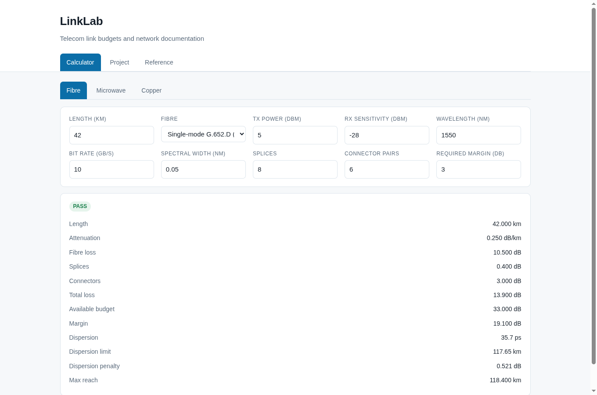
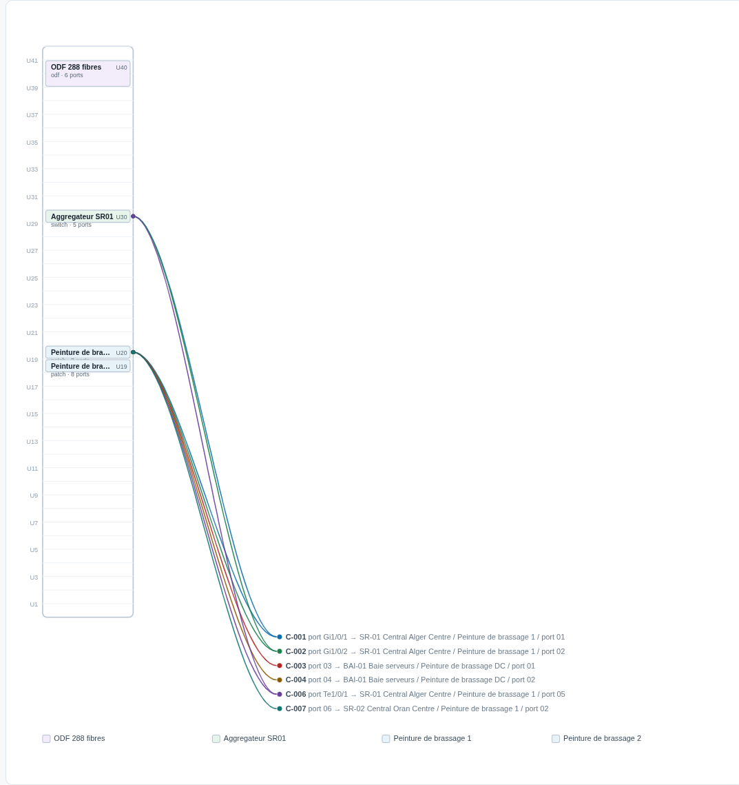
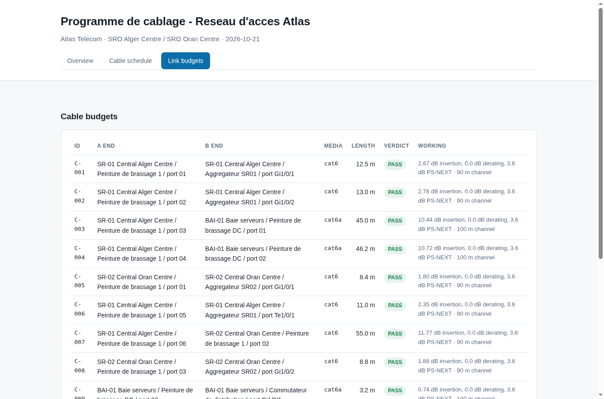

# LinkLab

**Telecom link budgets and network documentation, done properly.**

Three link-budget engines (optical fibre, point-to-point microwave, balanced
twisted pair), a project model that refuses to document a broken design, and
a generator that turns the whole thing into a documentation site with rack
elevations and a cable schedule.

No runtime dependencies. The engine, the CLI and the documentation generator
use only the Python standard library. The web UI is an optional extra.

**Live demo: [bougraimyou.github.io/linklab](https://bougraimyou.github.io/linklab/)**
— the generated documentation site for the worked example, published by
GitHub Actions on every push.



---

## Why this exists

I spent five months as an IT intern at a pharmaceutical production site,
doing first- and second-line support: Active Directory, Windows Server,
Microsoft 365, firewall and antivirus rollouts, a 12-port Cisco Catalyst
switch fault that took 20 users offline, and 30+ CAT6 runs terminated to
TIA/EIA-568-B. I also have an M.Eng. in Telecommunication Systems
Engineering.

Those two halves rarely meet. Network people use calculators that hide the
working, and telecom people use spreadsheets that break the first time a
splice count changes. This is one tool that does both, shows the working at
every step, and tells you *which* term closed the link.

---

## Quickstart

```bash
git clone https://github.com/bougraimyou/linklab.git
cd linklab
python3 -m linklab --help
```

The published demo of the documentation generator is at
<bougraimyou.github.io/linklab>.

No install is needed to run it from a checkout. To install it properly:

```bash
pip install -e .            # the engine and CLI
pip install -e '.[web]'     # ...and the web UI
```

### A fibre budget

```bash
linklab budget fiber --length 42 --fibre smf --tx 5 --rx -28 \
    --bitrate 10 --spectral-width 0.05 --splices 8 --connectors 6 --margin 3
```

```
Fibre budget  Single-mode G.652.D (standard SMF) @ 1550 nm
  length       42.000 km
  attenuation  0.250 dB/km -> 10.500 dB
  splices      0.400 dB
  connectors   3.000 dB
  total loss   13.900 dB
  budget       33.000 dB
  margin       19.100 dB
  dispersion   35.7 ps, limit 117.65 km
  max reach    118.400 km
  verdict      PASS
```

### A copper budget that fails, and says why

```bash
linklab budget copper --length 105 --category cat6 --pairs 4 --application 10gbase-t
```

```
Copper budget  Category 6 / 10gbase-t
  length       105.0 m
  channel      max 90 m
  permanent    max 90 m
  insertion    22.470 dB
  derating     6.000 dB
  PS-NEXT      3.600 dB
  total        32.070 dB of 21.4 dB allowed
  ! 105.0 m exceeds the 90 m channel limit.
  ! 105.0 m exceeds the 90 m permanent-link limit.
  ! Total budget 32.07 dB exceeds the 21.4 dB limit for Category 6.
  verdict      FAIL
```

Three reasons, not one. A tool that says only "FAIL" is a tool you have to
go and debug by hand.

### The web UI

```bash
linklab serve examples/site-atlas-telecom/project.json --port 8080
```

A calculator that recomputes as you type, the loaded project with every
cable's verdict, and a reference table of the fibre and copper parameters
with the standard each one comes from.

---

## The three engines

### Optical fibre

| Term | Source |
|---|---|
| Attenuation, 0.35 dB/km @ 1310 nm, 0.25 @ 1550 | ITU-T G.652.D |
| Bend-insensitive variant, same performance | ITU-T G.657.A1 |
| Reduced-loss variant, 0.22 dB/km @ 1550 | ITU-T G.655.E |
| Dispersion, 17 ps/(nm·km) for G.652 | ITU-T G.652 |
| Multimode reach, 4700 MHz·km for OM4 | ISO/IEC 11801 |
| Fusion splice 0.05 dB, mechanical 0.20 dB | typical field values |
| Mated connector pair 0.50 dB, field connector 0.75 dB | typical field values |

**There is deliberately no free-space path loss term in the fibre budget.**
FSPL describes radio propagation through air; light inside a glass core does
not suffer free-space spreading, and including it would understate every
optical link by more than 100 dB. It is a real mistake to make, and this
project has a regression test that catches it:

```python
def test_fibre_budget_has_no_free_space_path_loss_term():
    ...
    assert b.total_loss_db == pytest.approx(expected, abs=1e-9)
```

### Point-to-point microwave

FSPL *is* the dominant term here, and it is used properly:

```
FSPL(dB) = 92.44 + 20*log10(d_km) + 20*log10(f_GHz)
```

1 km at 1 GHz gives 92.44 dB, the figure in every propagation table. The
engine then carries EIRP, both antenna gains, feeder losses, the receiver
threshold, a required fade margin, and a rain-fade allowance reported
separately from the clear-air margin.

### Balanced twisted pair

Governed by ANSI/TIA-568-C.1:

- channel and permanent-link length limits (90 m for Cat5e and Cat6, 100 m
  for Cat6A);
- maximum insertion loss per category (20.8 dB for Cat5e, 21.4 for Cat6,
  23.2 for Cat6A);
- insertion-loss derating for multi-pair applications (3.5 dB for one pair
  on 10GBASE-T, 6.0 dB for four, 7.3 dB for 40GBASE-T);
- the PS-NEXT penalty that comes with using more than two pairs
  (+3.6 dB going from two to four).

---

## Projects, validation and generated documentation

A project is a JSON file: racks, the panels in them, their ports, the cables
between the ports, and the optical spans between sites.

```bash
linklab project validate examples/site-atlas-telecom/project.json
linklab docs build      examples/site-atlas-telecom/project.json --out site/
```

The validator is the interesting part. It reports **every** design error it
finds, not the first one, because a designer should be able to fix them in
one pass:

```
ERROR: Panel PP2 occupies U19-U19 but rack SR01 is only 18U high. [PP2]
ERROR: Cable C-009 starts at SR01.PP1.09, which is not a known port. [C-009]
ERROR: Port SR01.PP1.01 is terminated by 2 cables (C-001, C-010); a port takes one cable. [SR01.PP1.01]
```

`docs build` refuses to document a project with errors, because a document
should not hide a design fault. `--force` documents anyway, and the findings
are printed on the site.

### What the generator produces



- an **overview** with the headline numbers and any design findings;
- the **cable schedule**, one row per cable, both ends resolved to
  "rack / panel / port";
- the **link budgets** with the working, not just the verdict;
- a **rack elevation** per rack: the panels drawn to scale in rack units, and
  every cable drawn out to a labelled row. The drawing is two columns on
  purpose — a rack on the left, a cable ladder on the right — because the
  obvious way to draw this, labelling each cable where it leaves the port,
  puts the labels on top of each other the moment two cables share a panel.



---

## Checking the numbers

Every expected value in the test suite is hand-computed or taken from a
published figure, never captured from the implementation, so a reviewer can
check the arithmetic with a calculator and a standard.

```bash
pip install pytest
python3 -m pytest
```

```
53 passed
```

The suite covers the free-space formula against the textbook 92.44 dB, the
dispersion penalty against the standard 2.36 dB figure for a 100 km
single-mode span at 10 Gb/s, the dispersion limit, the modal-bandwidth limit
for multimode, the exact maximum reach, the TIA channel and permanent-link
limits, the derating table, and the project validation rules.

---

## Layout

```
linklab/
  units.py        dB arithmetic and the path-loss / dispersion formulas
  media.py        fibre, copper, splice and connector parameters, with sources
  budget.py       the three budget engines
  models.py       the project data model
  project.py      load, save and validate
  docs.py         the static site generator
  server.py       the web UI (optional extra)
  cli.py          the command line
  static/         the web UI's HTML, CSS and JavaScript
tests/            53 tests
examples/         a worked example: an Algerian access network
docs/             screenshots and sample CLI output
```

---

## Honest limitations

- It is a **calculation and documentation tool**, not a network management
  system. It does not poll equipment, discover topology or raise alarms.
- The **copper model covers the permanent link and channel**, not every
  alien-crosstalk and return-loss parameter in the full TIA suite. It
  implements the limits that decide a design: length, insertion loss,
  derating, PS-NEXT.
- The **rain-fade allowance is an input, not a calculation.** LinkLab does not
  implement ITU-R P.308; you bring the fade value for your site, or leave it
  at zero for a clear-air check.
- The **fibre dispersion model is a single-wavelength worst case** using the
  source spectral width. It does not model DWDM, Raman or nonlinear effects.
- The **web UI is a calculator and a viewer.** It does not edit a project;
  the project file is the source of truth.

---

## Licence

MIT. See [LICENSE](LICENSE).

The standards and the typical field values in `media.py` are cited with their
source in the code, so a reviewer can check where each one comes from.
